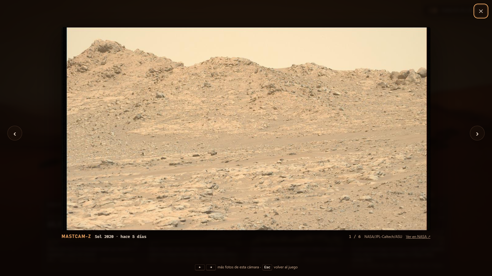

<div align="center">

# 🔴 Perseverance · Jezero

**Conduce a Perseverance por las dunas de Marte, en tiempo real y en tu navegador.**

Simulación 3D del rover Perseverance de la NASA en el cráter Jezero, construida con Three.js y el modelo 3D oficial de la NASA.


[](https://github.com/nasa/NASA-3D-Resources)


</div>

## 🚙 El rover

| | |
|---|---|
| 🛰️ **Modelo oficial** | El GLB de [NASA-3D-Resources](https://github.com/nasa/NASA-3D-Resources) a tamaño real: 2.70 m de ancho, 3.11 m de largo y 2.23 m de alto, con el mástil desplegado y el brazo guardado, como cuando conduce. |
| 🎮 **Conducción** | Avanza, retrocede y gira sobre su eje. Se apoya en sus 6 ruedas y se inclina siguiendo las dunas. |
| 🛞 **Ruedas** | Las 6 ruedas ruedan según la velocidad y las 4 de las esquinas se orientan como en el rover real: en curva al avanzar y en diamante al girar en el sitio. |
| 🪨 **Rocas** | Las piedras de más de 40 cm (lo que evita el rover real) lo detienen, y si llega en diagonal se desliza por el borde. Las más bajas las trepa: la rueda que pisa una sube y el rover se ladea. |
| 👣 **Huellas** | Dos bandas sobre la arena con el relieve en chevrón de los grousers, marcado por la luz rasante del sol. |
| 🎥 **Cámara de seguimiento** | Se coloca detrás del rover al conducir y puedes girarla alrededor con el mouse. Tiembla cuando las ruedas pasan sobre piedras, más fuerte cuanto más alta es la piedra; si prefieres una cámara quieta, apágalo con el switch **Temblor de cámara** de arriba a la derecha. |
| 📷 **Cámaras a bordo** | Cuatro cámaras brillan sobre el modelo y toman fotos reales de Marte (ver abajo). Al cargar, la consola lista las 8 cámaras del modelo. |

## 📸 Fotos reales de Marte



Sobre el rover brillan cuatro puntos: **Mastcam-Z**, **Navcam**, **Hazcam delantera** y **WATSON**. Al pasar el mouse dicen su nombre; al hacer clic suena el obturador (en imagen: cortinilla y flash) y aparece una **foto cruda real** de esa cámara, que se revela de arriba abajo como si bajara de Marte. Se queda unos segundos a la vista; un clic la amplía, las flechas recorren las demás fotos de esa cámara y `Esc` vuelve al juego. Cada clic en el punto trae la siguiente.

Las fotos vienen en vivo de la [API de imágenes crudas de Mars 2020](https://mars.nasa.gov/mars2020/multimedia/raw-images/). De entre las más recientes de cada cámara se escogieron a mano las que se sienten Marte (horizontes, el brazo sobre el suelo, rocas de cerca), todas a color y sin cielo vacío, sol, calibración ni miniaturas. Cada una dice su cámara, el sol en que se tomó y hace cuántos días.

## 📡 Control de misión


Una barra al pie de la pantalla (se muestra u oculta con la tecla `T`) con **datos reales** del Perseverance de verdad. Cada tarjeta trae el valor actual, una gráfica de toda la misión por soles (días marcianos) y una frase que explica qué significa.


| Dato | Fuente |
|---|---|
| 🛣️ **Distancia recorrida** (km) | Paradas de la misión que publica la NASA ([M20_waypoints.json](https://mars.nasa.gov/mmgis-maps/M20/Layers/json/M20_waypoints.json)), leídas en vivo |
| ⛰️ **Altura del terreno** (m sobre el nivel de referencia de Marte) | Mismo archivo de la NASA |
| 📐 **Inclinación** del rover al terminar cada manejo (°) | Mismo archivo de la NASA |
| 📶 **Tiempo de luz Tierra-Marte** (min) | Calculado en vivo con las órbitas de la Tierra y Marte (elementos keplerianos de JPL) |

Está organizado con el patrón de telemetría de [Open MCT](https://github.com/nasa/openmct), el software de control de misión de la NASA. Cada dato declara su nombre, su unidad y quién lo provee. El panel pide el historial con `request()` y recibe los valores en vivo con `subscribe()`, siempre a través de la API y sin tocar las fuentes directamente. Para agregar un dato nuevo basta con escribir un proveedor.

## ✨ El paisaje


| | |
|---|---|
| 🏜️ **Dunas** | Terreno procedural con crestas esculpidas por el viento: ladera suave a barlovento, caída abrupta a sotavento y rizos finos en la arena. |
| 🪨 **Rocas** | Cientos de piedras generadas con ruido, repartidas con una distribución realista de tamaños y asentadas sobre el relieve. |
| 🌅 **Cielo marciano** | Shader propio con degradado caramelo, velos de polvo en el horizonte y el **halo azulado** que rodea al sol en los atardeceres reales de Marte. |
| ☀️ **Sol de tarde** | Luz cálida y rasante con sombras suaves que siguen a la cámara. |
| 🌑 **Fobos y Deimos** | Las dos lunas de Marte, irregulares y con cráteres, flotando en el cielo polvoriento. |
| 🌫️ **Atmósfera** | Partículas de polvo arrastradas por el viento, niebla de distancia y posprocesado cinematográfico (bloom, viñeta y grano de película). |

El paisaje es **procedural**: no usa texturas ni modelos descargados, solo código. Lo único externo es el modelo del rover y los datos de telemetría de la NASA.

## 🚀 Empezar

Requiere [Node.js](https://nodejs.org/) 20.19 o superior (lo pide Vite 8).

```bash
git clone https://github.com/endiba360/perseverance.git
cd perseverance
npm install
npm run dev
```

Abre http://localhost:5173, haz clic en la escena y conduce:

| Control | Acción |
|---|---|
| `W` / `↑` | Avanzar |
| `S` / `↓` | Retroceder |
| `A` / `←` | Girar a la izquierda |
| `D` / `→` | Girar a la derecha |
| `T` | Mostrar u ocultar el control de misión |
| Clic en un punto brillante | Tomar una foto real con esa cámara |
| Clic en la foto · `←` `→` · `Esc` | Ampliarla · ver más de esa cámara · volver al juego |
| Switch "Temblor de cámara" | Activar o desactivar el temblor al pasar sobre piedras |
| Arrastrar con el mouse | Girar la cámara alrededor del rover |
| Rueda del mouse | Acercar / alejar |

> El rover real avanza a unos 4 cm/s; aquí va a 2.5 m/s para que sea jugable.

## 🧪 Verificación visual

```bash
npm run check
```

Abre la escena en tu Chrome instalado en modo invisible (con [Playwright](https://playwright.dev/) y sin descargar navegadores) y comprueba:

- **Control de misión:** que carguen sus 4 datos y que la tecla `T` lo oculte y lo vuelva a mostrar.
- **Ruedas:** que rueden a la velocidad correcta y que las esquinas se orienten al girar.
- **Huellas:** que se dibujen también en reversa y al girar en el sitio.
- **Rocas:** que una grande detenga al rover sin traslaparse y que trepe y cruce una pequeña.
- **Temblor de cámara:** que la sacudida aparezca sobre la piedra y no en la arena, y que el switch venga activado, se apague y se vuelva a encender con clics reales.
- **Fotos:** que cada una de las 4 cámaras abra una foto real con un clic, que la foto se amplíe, que las flechas la recorran sin mover al rover y que `Esc` la cierre.

Guarda dos capturas, `screenshots/check.png` (la escena) y `screenshots/photo.png` (una foto ampliada), y lista los mensajes y errores de consola. Termina con código 1 si encuentra algún error.

## 🗂️ Estructura

```
src/
├── main.js            punto de entrada: conecta motor, mundo y rover
├── engine.js          renderer, cámara, controles y bucle de animación (con efectos antes de dibujar)
├── debug.js           ganchos para la consola y npm run check
├── rover/
│   ├── rover.js       carga del modelo, pose de conducción y lista de cámaras
│   ├── controller.js  conducción e inclinación sobre el terreno
│   ├── wheels.js      ruedas separadas: rodadura y dirección
│   ├── collisions.js  choque con las rocas grandes
│   ├── tracks.js      huellas de las ruedas
│   ├── followCamera.js cámara que sigue al rover
│   └── cameraShake.js temblor de cámara sobre las piedras
├── telemetry/
│   ├── telemetry.js   mini API de telemetría al estilo Open MCT
│   ├── waypointsProvider.js  distancia, altura e inclinación (datos de la NASA)
│   ├── lightTimeProvider.js  tiempo de luz Tierra-Marte en vivo
│   └── orbits.js      posiciones de la Tierra y Marte
├── photos/
│   ├── picks.js       fotos escogidas por cámara
│   └── rawImages.js   pide cada foto a la API de imágenes crudas de la NASA
├── hud/
│   ├── hud.css            colores compartidos del HUD
│   ├── missionControl.js  panel de control de misión (tecla T)
│   ├── shakeToggle.js     switch del temblor de cámara
│   ├── cameraSpots.js     puntos brillantes sobre las cámaras del rover
│   └── photoViewer.js     obturador, foto que se revela y vista ampliada
├── world/
│   ├── world.js       arma el paisaje completo
│   ├── terrain.js     dunas y relieve (altura exacta para apoyar objetos)
│   ├── sky.js         shader del cielo y disco solar
│   ├── lighting.js    sol con sombras + luz del cielo
│   ├── rocks.js       rocas procedurales instanciadas
│   ├── rockField.js   posición y altura de cada roca (para chocar o trepar)
│   ├── moons.js       Fobos y Deimos
│   └── dust.js        polvo en suspensión
├── post/composer.js   bloom, viñeta y grano
└── utils/noise.js     ruido simplex con semilla
public/
├── models/perseverance.glb  modelo oficial de la NASA (comprimido con Draco)
└── draco/                   decodificador Draco (lo copia npm install)
scripts/
├── check.mjs          verificación headless
└── copy-draco.mjs     copia el decodificador Draco desde three
```

## 🛰️ Próximos pasos

- [x] Paisaje marciano cinematográfico
- [x] Modelo oficial del rover a tamaño real
- [x] Conducción con teclado, huellas y cámara de seguimiento
- [x] Ruedas que giran y dirección de las 4 esquinas
- [x] Control de misión con telemetría real de Perseverance
- [x] Colisiones con las rocas y trepado de piedras pequeñas
- [x] Temblor de cámara sobre las piedras, con switch para apagarlo
- [x] Fotos reales de Marte desde las cámaras del rover
- [ ] Vistas 3D desde las cámaras del rover (Mastcam-Z, Navcams, Hazcams…)

## 📄 Licencia

Código bajo licencia [MIT](LICENSE) · Proyecto de aprendizaje de [Platzi](https://platzi.com). No está afiliado a la NASA.

Modelo 3D de Perseverance: [NASA-3D-Resources](https://github.com/nasa/NASA-3D-Resources), cortesía de NASA/JPL-Caltech. Datos de las paradas del rover: mapa de la misión Mars 2020 (MMGIS) de NASA/JPL-Caltech. Fotos crudas: NASA/JPL-Caltech (Mastcam-Z: NASA/JPL-Caltech/ASU).
